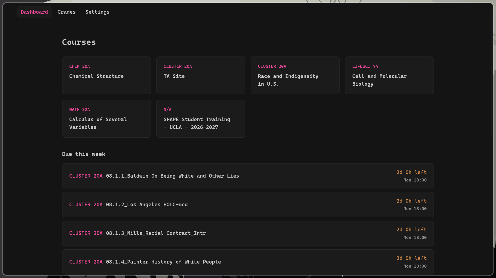

# Canvas
Desktop client for canvas w/ Tauri + Svelte  
Only works for ucla canvas  
100x faster than the website!!!  
Synced grade calculation from gradescope

## Run
`sudo pacman -S webkit2gtk-4.1' (arch)  
'npm i`  
`npm run tauri dev`

## Building
Linux:  
builds + installs to ~/.local/bin/canvas  
`npm run install-app`  
  
Mac:  
`xcode-select --install`  
`curl --proto '=https' --tlsv1.2 -sSf https://sh.rustup.rs | sh`  
`npm run tauri build`  
drag dmg in src-tauri/target/release/bundle/dmg/ to Applications  
sign the app if needed  
`xattr -cr /Applications/Canvas.app`

Windows  
idk if theres a package manager  
[install visual studio build tools](https://visualstudio.microsoft.com/downloads/) (bottom of page under 2. tools for...) + [rust](https://rustup.rs/)  
`npm run tauri build`  
run the installer in src-tauri\target\release\bundle\nsis\

## Login:
Use SSO or auto detect logged-in browser  
Auto-detect only works for firefox on mac/windows because of cookie security

## How it works
- Session cookie is saved in webview cookie store  
- Rust for api calls  
- Every API response is cached to disk (preloading!!!)

