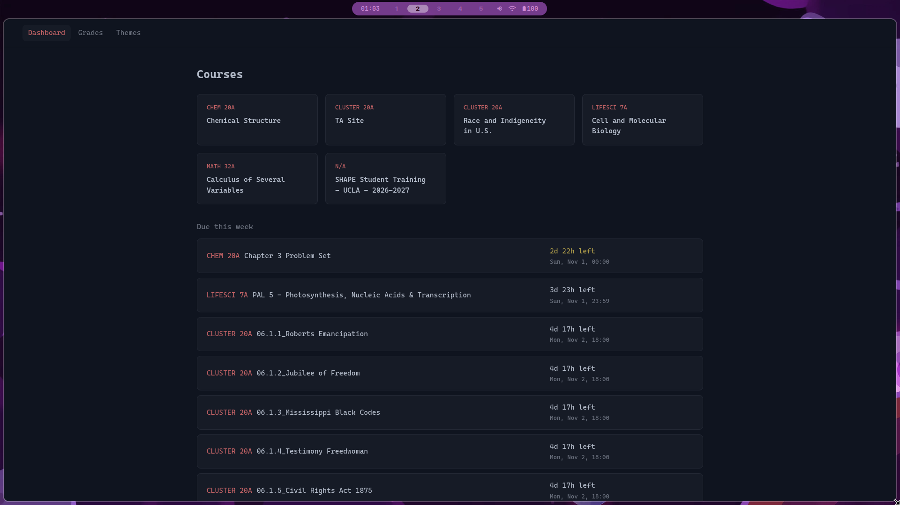

# Canvas
Desktop client for canvas w/ Tauri + Svelte
Only works for ucla canvas

## Setup (arch)
`sudo pacman -S webkit2gtk-4.1
npm i`

## Run
dev:  
`npm run tauri dev`

build + install to ~/.local/bin/canvas  
`npm run install-app`  

## What it does
Login: a window opens SSO. Session cookie is saved in webview cookie store -> rust for api calls
Every API response is cached to disk (preloading!!!)

